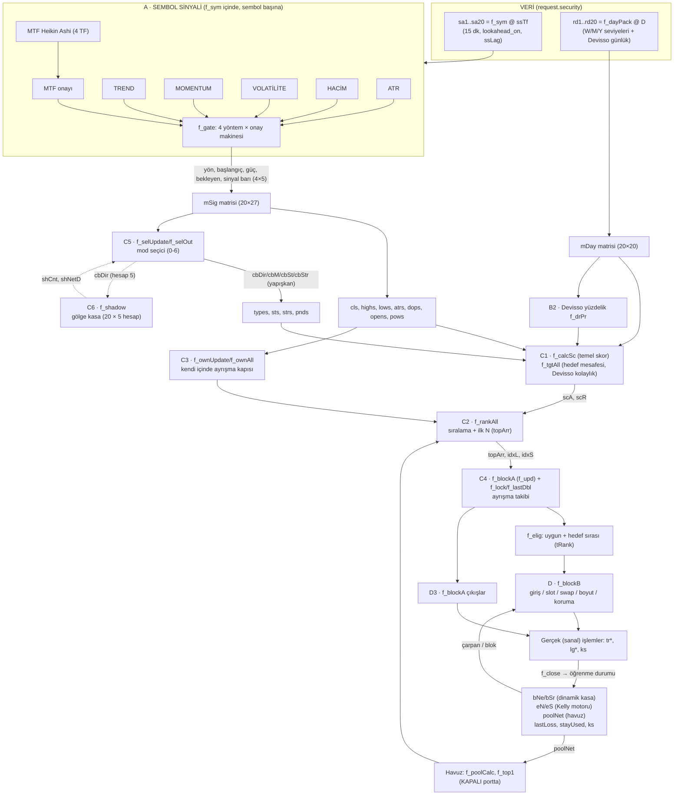

# DEPV2 — Modül Bağımlılık Şeması

Kaynak: `Devis'So Otomatik Bot Eğitim Paneli.txt` (orijinal DEPV2, 2473 satır). Bu belge modüllerin **ne yaptığını** değil **birbirine nasıl bağlandığını** anlatır: veri akışı, bir barın çalışma sırası, paylaşılan durum ve henüz birlikte sınanmamış bağlantılar. Ayrıntılı modül anlatımı için bkz. `DEPV2_DOKUMAN.md`.

Üretim yöntemi: fonksiyonlar, çağrı sırası ve durum (`var`) okuma/yazma ilişkileri orijinal koddan bir betikle statik olarak taranarak çıkarıldı (90 fonksiyon, 103 `var` tanımı), sonra elle kontrol edildi. Satır numaraları orijinal dosyaya aittir. Statik tarama "bu fonksiyon bu diziyi yazar/okur" der; koşullu dalları ya da çalışma anındaki değerleri göstermez.

---

## 1. Katmanlar ve veri akışı

Okuma ipucu: düz ok = aynı barda akan veri; kesikli ok = çapraz bağ (bir barın çıktısı sonraki barlarda girdi olur).

---

## 2. Bir barın çalışma sırası (kapanmış 15 dk bar, `barstate.isconfirmed and ssNew`)

Orijinalde top-level satır sırası bağlayıcıdır. Aşağıdaki sıra koddan çıkarıldı:

| # | Satır | Adım | Koşul | Yazdığı durum |
|---|---|---|---|---|
| 1 | 591-610 | `sa1..sa20` (f_sym: A1–A8 sembol başına) | her bar | (içeride f_gate `var`'ları) |
| 2 | 667-686 | `rd1..rd20` (f_dayPack: B1/B2) | her bar | — |
| 3 | 775-789 | `mSig`, `mDay`; `cls, highs, lows, atrs, dops, opens, pows` | her bar | — |
| 4 | 914 | `f_selUpdate()` (C5) | `isconfirmed` | `cbDir, cbM, cbSt, cbStr, autoM` |
| 5 | 939 | `f_selOut()` → `types, sts, strs, pnds, pcts` | her bar | — |
| 6 | 1024 | `f_calcSc()` → `scA` | her bar | — |
| 7 | 1049 | `f_poolCalc()` → `poolA` (havuz) | her bar | — |
| 8 | 1079 | `f_ownUpdate()` (C3) | `isconfirmed and ssNew` | `ownRing, ownCnt, legMax, legDir` |
| 9 | 1125 | `f_ownAll()` → `ownOkA` | her bar | — |
| 10 | 1152 | `f_tgtAll()` → `scR` (hedef mesafesi + Devisso kolaylık) | her bar | — |
| 11 | 1182 | `f_top1()` (1. sıra koruması; havuz okur) | her bar | — |
| 12 | 1215 | `f_rankAll()` → `idxL, idxS, topArr` (C2) | her bar | — |
| 13 | 1857 | `f_shadow()` (C6) | `isconfirmed and ssNew` | `sh*` (10 dizi) |
| 14 | 1858 | `f_blockA()` (C4 takip + D3 çıkışlar) | `isconfirmed and ssNew` | `actA, cntA, dirA, entA, mxA, mnA, resMv, resDb, trMfe` + `f_close` ile tüm tr/ks/öğrenme durumu |
| 15 | 1880 | `f_elig()` → `eligA, tRank` | her bar | — |
| 16 | 2049 | `f_blockB()` (giriş, slot, swap, boyut, koruma) | `isconfirmed and useTrade and ssNew` | `tr*`, `lg*`, `dg`, `kl`, `dyn`, `bNe/bSr`, `eN/eS/eS2`, `poolNet`, `stayUsed`, `offCnt`, `idSeq` |
| 17 | 2062 | `f_peak()` (kasa zirvesi, maks DD) | `isconfirmed and ssNew` | `ks[1], ks[2]` |
| 18 | 2095+ | `f_live`, tablolar, etiketler | her bar | (yalnızca görsel) |

**Sıra kuralları (bozulursa sonuç değişir):**
- Seçici (4) gölge kasadan (13) **önce** çalışır; seçici gölge durumunu **önceki barın** değeriyle okur. (C6'da ölçüldü.)
- `f_blockA` (14) `f_elig`'den (15) önce çalışır; uygunluk **bu barda güncellenmiş** `actA/cntA` ile hesaplanır.
- Çıkışlar (14) girişlerden (16) önce çalışır; aynı barda önce slot boşalır, sonra yeni giriş denenir.
- `f_blockB` içinde sıra: havuz sönümleme → `f_dynUpdate` → Kelly motoru sönümleme → sert DD → günlük kayıp → kasa kâr kilidi → slot ve giriş döngüsü.
- `ssIdx` sayacı ilk barda artmaz (`timeframe.change` ilk barda `false`), Python'da 0'dan başlar. (C6'da ölçüldü.)

---

## 3. Durum envanteri — kim yazar, kim okur

Tarama sonucu. "Python" sütunu mevcut portun durumunu gösterir.

### 3.1 Sinyal ve seçim

| Durum | Yazan | Okuyan | Python |
|---|---|---|---|
| f_gate içi (`confDir, pendDir, lastSig…`) | `f_gate` (yöntem başına örnek) | `f_gate` | `gate.py` ✔ |
| `cbDir, cbM, cbSt, cbStr` | `f_setSel`, `f_selUpdate` | `f_selOut`, `f_shadow` (hesap 5), `f_blockB` (`cbM`) | `selector.py` ✔ |
| `autoM` | `f_selUpdate` | tablo | `selector.py` ✔ |
| `shDir…shSumR` (10 dizi) | `f_shadow` | `f_selUpdate` (`shCnt, shNetD`), tablolar | `shadow.py` ✔ |

### 3.2 Sıralama ve ayrışma

| Durum | Yazan | Okuyan | Python |
|---|---|---|---|
| `ownRing, ownCnt, legMax, legDir` | `f_ownUpdate` | `f_ownGate` | `own_divergence.py` ✔ |
| `cntA, actA, entA, dirA, resMv, resDb` | `f_upd` (`f_blockA` içinden) | `f_own`, `f_sc`, `f_lock`, `f_lastDbl`, `f_elig`, `f_live` | `divergence.py` ✔ |
| `mxA, mnA` | `f_upd` | **hiçbiri** (ölü durum) | taşınmadı |
| `poolNe, poolNet` | `f_close`, `f_blockB` (sönümleme) | `f_poolCalc`, `f_top1` | **yok** (havuz kapalı) |

### 3.3 İşlem, kasa ve öğrenme (Python'da: engine.py, kelly.py, pool.py — hepsi taşındı ve doğrulandı)

| Durum | Yazan | Okuyan | Not |
|---|---|---|---|
| `trAct, trDir, trEnt, trRu, trTp, trNot, trSlot, trId, trRk, trDvn, trOpS, trMeth, trStr, trEase, trBar` | `f_blockB` (açış), `f_close` (`trAct`) | `f_unreal`, `f_heat`, `f_blockA`, `f_close`, tablolar | açık işlem kaydı; `f_close` çoğunu okur |
| `trMfe` | `f_blockA`, `f_blockB` | `f_close` | kâr geri verme çıkışının girdisi |
| `lg*` (işlem günlüğü halkası) | `f_blockB`, `f_close` (`lgExit, lgSt`) | tablolar | görsel/kayıt; karar vermez |
| `ks[0..9]` (gerçekleşen kasa, zirve, maks DD, brüt kâr/zarar, maliyet, seri…) | `f_close`, `f_peak` | `f_dynUpdate`, `f_dynState`, `f_entryMult`, `f_blockB` | **kasa değeri her yerde `ks[0] + f_unreal()`** |
| `lastLoss` | `f_close` (zararlı kapanış) | `f_qual` (soğuma) | Python'da şimdilik gölge kasadan beslenen geçici kaynak |
| `stayUsed, offCnt` | `f_blockB`, `f_close` (`stayUsed`) | `f_blockB` | tekrar giriş hakkı |
| `idSeq` | `f_blockB` | — | işlem numarası |
| `bNe, bSr` (36 kova) | `f_close`, `f_dynUpdate` (sönümleme) | `f_dyn` → `f_entryMult` | **dinamik kasa öğrenmesi** |
| `dyn` (3) | `f_dynUpdate` | `f_dynState`, `f_entryMult` | dinamik kasa DD durdurması |
| `dg` (6), `kl` (3) | `f_blockB` | `f_dynState` | sert DD, günlük kayıp, kasa kâr kilidi |
| `eN, eS, eS2` (60 kova) | `f_engAcc` (`f_close`), `f_blockB` (sönümleme) | `f_engine` | **Kelly motoru öğrenmesi** |
| `tCnt…tSumUsd`, `symN, symNet`, `lsW…lsH`, `xc` | `f_close`, `f_acc` | tablolar | istatistik; karar vermez |

---

## 4. Çapraz bağlar ve geri besleme döngüleri

Bunlar modüllerin tek tek doğruluğunun yetmediği yerlerdir.

| # | Döngü / bağ | Yol | Port durumu |
|---|---|---|---|
| L1 | **Otomatik mod ↔ gölge kasa** | gölge net K/Z → yöntem seçimi → hesap 5 yönü → gölge net K/Z | C5+C6 birlikte doğrulandı ✔ |
| L2 | **Kasa → boyut → kasa** | `ks[0]+f_unreal` → `eqNow` → notional → kâr/zarar → `ks[0]` | D4/D5 ile gelecek |
| L3 | **Dinamik kasa öğrenmesi** | `f_close` → `bNe/bSr` → `f_dyn` → giriş çarpanı | orijinalde varsayılan açık; Python'da **dışarıda** |
| L4 | **Kelly motoru öğrenmesi** | `f_close` → `eN/eS` → `f_engine` çarpan/blok | varsayılan açık; Python'da **dışarıda** |
| L5 | **Havuz** | `f_close` → `poolNet` → `f_top1`/havuz → sıralama → eligible | varsayılan açık; Python'da **dışarıda** |
| L6 | **Soğuma** | zararlı `f_close` → `lastLoss` → `f_qual` → giriş engeli | D1'de geçici kaynakla doğrulandı; D3'te gerçek kaynağa bağlanacak |
| L7 | **Çıkış → slot → giriş** | `f_blockA` çıkışı → `trAct=false` → aynı barda `f_blockB` yeni giriş | D2/D3 |
| L8 | **Swap** | `scR` (hedef mesafesi skoru) → zayıf açığı kapat (`f_close` st=2) → yeni giriş | D2 |
| L9 | **Koruma → durdurma** | DD / günlük kayıp / kâr kilidi → `f_closeAll` → `dg/kl` bekleme → `f_blockB` giriş engeli | D5 |
| L10 | **Ayrışma takibi ↔ işlem** | `f_upd` (`isconfirmed`) → `cntA/actA` → `f_elig` → giriş; açık işlem sırasında ayrışma bitince sıralama çıkışı | C4 ✔, bağlantısı D3 |

**Paylaşılan yazar uyarıları** (aynı durumu birden çok yer yazar):
- `poolNet`: `f_close` ve `f_blockB` (sönümleme). Havuz kapalıyken ikisi de etkisiz.
- `stayUsed`: `f_blockB` (sıfırlama/işaretleme) ve `f_close`.
- `trMfe`: `f_blockA` (güncelleme) ve `f_blockB` (açılışta sıfırlama).
- `ks`: `f_close` (muhasebe) ve `f_peak` (zirve/DD). Sıra: `f_blockB` → `f_peak`.
- `lastLoss` Python'da iki kaynaklı olabilir (gölge kasa test kaynağı ve gerçek işlem). Gerçek işlem katmanı gelince tek kaynak olmalı.

---

## 5. Kapanmamış bar ve veri zamanlaması

- Tüm durum bloklarının koşulu `barstate.isconfirmed` (ve çoğunda `ssNew`). Kapanmamış bar durumu **ilerletmez**, yalnızca değerlendirir. Canlıda Python da yalnızca bar kapanışında durum ilerletmelidir (C3, C4, C5, C6'da ölçüldü).
- `request.security(..., lookahead_on)` + `ssLag`: sembol verisi kapanışta hizalanır. Geçmiş ve canlı barlarda günlük seviyeler ve Devisso gecikmesi farklıdır (ölçüldü); **Python canlı davranışı esas alır** (M1'de ayrıca ele alınacak).
- Bağımsız zaman dilimleri: sinyal 15 dk, MTF HA 30/45/60/90 dk, günlük paket (`D`). Hepsi aynı kapanmış 15 dk barda hizalanmalı.

---

## 6. Doğrulama kapsamı

### 6.1 Tek tek doğrulanan (hepsi TradingView ile 0 uyuşmazlık)

A1–A8, B1, B1b, B2, C1a/b/c, C2, C3, C4, C5, C6, D1 (modül modül, TradingView göstergeleriyle). Bütün-sistem: SIG, SIGA (Otomatik mod), DAY (günlük paket), SIGT/SIGD (hedef mesafesi + Devisso kolaylık puanı), S0–S10. S11/S12 (dinamik kasa, varsayılan ve sıkı ayarlar) TradingView ile 0 uyuşmazlık.

### 6.2 Birlikte doğrulanan zincirler

| Zincir | Durum |
|---|---|
| A1…A7 → A8 (4 yöntem + onay) | ✔ gerçek veriyle |
| A8 → C5 → C6 (sinyal → seçici → gölge kasa → Otomatik mod) | ✔ gerçek veriyle, tek sembol |
| **A1…A8 → C5 → C1 → C3 → C2 → C4 (20 sembol, gerçek veri)** | ✔ **orijinal DEPV2 ile bütün-sistem karşılaştırması: yön, skor, hedef sırası, ilk N, uygunluk, kendi-içi kapı; 63 sütun, 3.998 bar, 0 uyuşmazlık** (referans yapılandırma: "Aynı anda conf", hedef puanı/Devisso/havuz/motor/dinamik kasa kapalı) |
| A8 → C6 → D1 (gölge `lastLoss` → giriş kalitesi) | ✔ gerçek veriyle, tek sembol |

### 6.3 Birlikte doğrulanmayan (açık risk)

| Zincir | Neden önemli |
|---|---|
| **İşlem motoru (S0–S6), 20 sembol, orijinal DEPV2 ile** | ✔ **7 basamak, her birinde pozisyon yönü / giriş fiyatı / büyüklük / kasa / zirve / maks DD / kapanan işlem sayısı birebir.** Kapsanan kurallar: giriş uygunluğu + D1 filtreleri, tek ve 4 slot, swap, hedef #2 çarpanı, risk % + hard kap + kaldıraç tavanı + ısı limiti, ters sinyal / kâr geri verme / stop / TP / zaman çıkışları, kasa kâr kilidi + `negMult`, sert DD, günlük kayıp (durdurma ve kapatma). Pencere: son ~4000 bar (≈42 gün), 143-203 işlem/basamak. |
| ~~A8 → C1 → C2 → C4 gerçek zincir~~ | **KAPANDI** (yukarıdaki bütün-sistem karşılaştırması). Hedef mesafesi puanı ve Devisso kolaylık puanı hâlâ kapalı yapılandırmada sınanmadı (günlük veri gecikmesi nedeniyle ayrı basamak). |
| ~~Çok sembollü gerçek zincir~~ | **KAPANDI** (20 sembol, sembol indeksleme, `na` yayılımı dahil). |
| ~~Ayrışma takibi ↔ işlem~~ | **KAPANDI** (S0–S17: sıralama/ayrışma bitince kapanış dahil, motorla birlikte doğrulandı). |
| **Başlangıç durumu yakınsaması** | Pencere içi başlangıç duyarlılığı ölçüldü (6.4c). Canlıda Python'un geçmişle ısınıp orijinalle yakınsaması (M1d) hâlâ ölçülmedi. |
| ~~D1 → giriş akışı~~ | **KAPANDI** (S0–S17 giriş filtreleri, blok, ısı, slot birlikte doğrulandı). |

### 6.4 Önceden bilerek dışarıda bırakılanlar — HEPSİ TAŞINDI (16 Eki 2026)

Havuz, `f_top1`, Kelly motoru, dinamik kasa ve Devisso çarpanı/DR blok artık Python'da ve ayrı basamaklarla TradingView'a karşı doğrulandı (S8–S17). S17, orijinalin hiçbir girdisi değiştirilmeden tüm varsayılanlarıyla 0 uyuşmazlıkla tuttu. Hâlâ taşınmayanlar: dinamik kasa kovaları 7–11 (orijinalde karara girmiyor), "live" günlük eşleme.

---|---|---|
| Havuz, `f_top1` (L5) | `poolNet → sıralama` | sıralama orijinal varsayılandan farklı olabilir |
| Kelly motoru (L4) | `eN/eS → çarpan/blok` | boyut çarpanı ve bloklar farklı |
| Dinamik kasa (L3) | `bNe/bSr → çarpan`, `dyn` DD durdurması | boyut farklı |
| Devisso çarpanı (drM) ve DR blok | `f_drEase → drM, drBlk` | boyut ve bloklar farklı |

Bu nedenle ilk Python sürümü **varsayılan DEPV2 ile aynı işlemleri üretmeyecek**; bütünleşik doğrulama, orijinalde aynı bu özellikler **kapatılarak** yapılacak. Sonradan her biri açılıp doğrulanır.

---

### 6.4a Günlük paket (DAY) — doğrulanan kurallar

- Orijinalde `request.security(sembol, "D", f_dayPack())` çağrısında `lookahead` yoktur; **geçmiş** 15 dk barlar bir önceki günün kapanmış paketini görür, günün son barı (23:45) o günün kendi paketini görür. Canlıda son bar gelişen günün paketini görür. Doğrulandı: 3 sembol × 20 sütun + emtialar arası yüzdelik, 0 uyuşmazlık. Kodda bilerek olan tek gecikme Devisso'nun `drK[1]` kaydırmasıdır; geri kalanı TradingView davranışıdır.
- `calc_bars_count` günlük bağlamı da pencereden başlatır: günlük seri pencere içindeki ilk TAM günden başlar (pencere 4 Eylül 05:30'da başlarsa ilk günlük bar 5 Eylül). Bu yüzden debug penceresinde "yıl" ve "ay" o günden başlar, önceki dönem değerleri boştur.
- Üretimde Python günlük geçmişi tam kullanır (2019'dan beri); orijinalin debug penceresi bunun kısaltılmış hâlidir.

### 6.4b Hâlâ doğrulanmayan (motor tarafı)

- Hiçbir basamakta tetiklenmeyen alt durumlar: stop'ta açılış boşluğu (gap) dolumu, yalnızca TP ve stop aynı barda, `allowL/allowS` kapalı yön, `reEntry=false`, yerel `sizeMode` dışı kombinasyonlar. Birim testlerle kapsandı ama TradingView'a karşı sınanmadı.
- Havuz ve Kelly motoru artık doğrulandı (S13–S17). Açık kalan: yukarıdaki tetiklenmeyen alt durumlar, 42 günlük tek pencere (başka tarih/rejim pencereleri), ay/yıl sınırı ve `dOpenHr` ≠ 0.
- Pencere yalnızca ≈42 gün. Daha uzun dönemde (ay/yıl sınırı, haftalık open) davranış sınanmadı.

### 6.4c Başlangıç duyarlılığı (path dependence) — ölçüldü

Aynı ayarlarla hesabın başlangıç barını 1 bar kaydırmak sonucu çok değiştirir (TradingView ile her başlangıçta uyuşur, yani hata değil, sistemin özelliği). Ölçüm (4000 bar penceresi, 20 sembol, 10 farklı başlangıç):

- S9 (dinamik kasa yok): 140–174 işlem.
- S11 (dinamik kasa, varsayılan): 21–170 işlem. Başlangıç 17972'de ilk haftadan sonra haftada 1–2 işleme düşüyor; aday değerlendirmelerinin %89'u dinamik kasa kova bloğuna takılıyor (başlangıç 17974'te %1,3).
- Mekanizma: kova bloğu (`ne ≥ 6` ve ort. R ≤ −0,5) yeni işlem açılmadığı için kovayı güncellemez; kova yalnızca ×0,97/96 bar sönümle çözülür (günde %3). İlk haftalarda biriken zararlı bir kova günlerce işlemi kilitleyebilir.

Sonuçlar: (1) tek bir backtest başlangıcına güvenilmemeli; birçok başlangıçtan dağılım bakılmalı. (2) Paper sürümde dinamik kasanın uzun işlemsiz dönemler yaratması beklenmeli; sönümleme/blok ayarları paper verisiyle değerlendirilecek. (3) Başlangıç yakınsama testi (M1) bu dağılımı da ölçmeli.

### 6.5 Bütün-sistem doğrulamasında öğrenilenler

- **`calc_bars_count` her bağlamı pencerenin başından başlatır.** Orijinal DEPV2 yalnızca son N barı hesaplar (varsayılan 4000, bellek sınırı yüzünden zorunlu; 22 bin barlık geçmiş "memory limit exceeded" verir). Bu pencere ana grafiği ve `request.security` bağlamlarını (sembol sinyalleri, MTF HA, gate durumu) birlikte sıfırdan başlatır. Python karşılaştırması bu yüzden her şeyi aynı pencere başından çalıştırır ("soğuk" mod); "sıcak" mod (sinyaller bütün geçmişte, kalan hat pencereden) 602 yön farkı verdi.
- **Hesap penceresi grafiğin yüklediği bar sayısından bağımsızdır.** Grafik yalnızca 1.321 bar yükleyince bile (CSV'de yalnızca o kadar satır var) orijinal hâlâ son ≈4000 bar için, bütün hattı (sembol sinyalleri + seçici + gölge kasa + sıralama + ayrışma + motor) o noktadan başlatarak hesapladı; Python bu pencere başından başlatılınca 63 + 7 sütun uyuştu (`--state-window`). CSV'nin ilk satırından başlatmak 10 binlerce hücrede fark verdi. Yani CSV'nin başlangıcı, hesabın başlangıcı demek değildir.
- Canlıda tersi geçerli olacak: Python bütün geçmişle ısınabilir. Bu da başlangıç yakınsama testi (M1) konusu.
- Debug CSV, veri dosyalarından yeniyse veri dosyasının son (canlı) satırı atılır; kalan son bar kapanmış sayılır.

### 6.5b Kelly motoru ve havuz — taşındı ve doğrulandı (16 Eki 2026)

- `alamet/kelly.py` (f_engIdx/f_engAcc/f_engSd/f_engine + sönümleme) ve `alamet/pool.py` (f_poolCalc, f_top1, sönümleme) yazıldı; `engine.py` kapanışta kovalara ve emtia net K/Z'sine yazar, girişte Kelly çarpanı ve BLOK uygular, `engReplace` açıkken dinamik kasa çarpanının ve DD kısıtının yerine geçer.
- Havuz sıralamanın içinde ve işlem sonuçlarından beslendiği için panel ile motor artık bağımsız değil: havuz açıkken `run_system` her barda havuz maskesini motor durumundan alıp sıralamayı ve ayrışma takibini bar bar yeniden hesaplar (`system._pooled_row`). Havuz kapalıyken eski hızlı yol.
- Doğrulama basamakları (TradingView, 20 sembol, 4000 bar, 0 uyuşmazlık): S13 (S9+Kelly), S14 (S11+Kelly sıkı), S15 (S9+havuz), S16 (S13+sıkı havuz), S17 (orijinalin varsayılan ayarlarının tamamı: Otomatik mod, hedef/Devisso puanı, dinamik kasa, Kelly, havuz).
- Kontrol grupları S9 ve S11 aynı dışa aktarımda yeniden 0 uyuşmazlıkla doğrulandı (yeni veriyle).
- Orijinalde kullanılmayan `f_mRank`, `idxNet` taşınmadı. Kalan taşınmayanlar: dinamik kasa kovaları 7–11 (karara girmiyor), "live" günlük eşleme.

### 6.5c Fonksiyon bazlı tarama (16 Eki 2026) — 90 `f_*` fonksiyonu

Orijinaldeki 90 fonksiyondan 50'sinin adı Python kaynağında geçiyor. Kalan 40'ının dökümü:
- **Görünüm / biçim / tablo / etiket (karara girmez):** f_sz, f_pos, f_cell, f_cellL, f_lg dışındakiler: f_nm, f_mv, f_bg, f_px, f_rr, f_rs, f_usd, f_amt, f_sv, f_stN, f_colS, f_col, f_dirTx, f_kv, f_pc, f_pf, f_lsRow, f_lsSection, f_tradeTbl, f_drawKs, f_drawLs, f_engRows, f_drawEng, f_drawMt, f_drawLbl.
- **Farklı adla taşınmış:** f_okArr/f_mk (dizi hazırlığı, yapısal), f_pdM (selector bekleyen yön), f_atrP (`atr_percent`), f_bA (`dyn_buckets` grup), f_dynUpdate (`dyn_update`), f_opS (`open_side`).
- **Karara girmeyen istatistik / gösterim:** f_acc (kova tabloları), f_live ve f_openDir (açık işlem özeti, etiketler).
- **f_lg:** `ssLag` gecikmesi (`x[1]`). Orijinalde `ssLag = grafik periyodu < ssTf ? 1 : 0`. Python grafik = sinyal TF'si durumunu (ssLag = 0) modelliyor; bot veriyi sinyal TF'sinde aldığı için sorun değil (ince veri önce `resample_universe` ile sinyal TF'sine çevrilir; `timeframe.ss_lag` yalnızca TV karşılaştırması içindir). Sinyal TF'si artık ayarlanabilir (bkz. 6.5k).

Sonuç: karar veren hiçbir fonksiyon taşınmadan kalmadı. Fonksiyon dışındaki üst düzey blokların (çıkışlar, korumalar, giriş döngüsü) birebirliği TV doğrulamasıyla kanıtlı; hangi dallarının tetiklendiği henüz sayılmadı (kapsam denetimi).

### 6.5-0 Kapsam ölçüleri ve doğru okunuşu (16 Eki 2026 düzeltmesi)

İki farklı ölçü var ve karıştırılmamalı:
- **Kod kapsamı (satır/dal):** doğrulama koşularında çekirdek Python kodunun %94'ü çalıştı (bölüm 6.5d/6.5e). Bu, kod yollarının çoğunun TV'ye karşı sınandığını gösterir; **girdi değerlerinin sınandığını göstermez** (aynı kod yolu farklı parametre değerleriyle çalışır).
- **Girdi uzayı kapsamı (asıl birebirlik ölçüsü):** orijinalde 184 girdi (18'i görünüm), 166 mantık girdisi. **83'ü (%50)** TV'de en az bir varsayılan dışı değerle sınandı; **83'ü yalnızca varsayılan değerinde**. Tam varsayılan yapılandırma (S17) birebir doğrulandı; değişen ayarlar için kanıt yarıya kadar. Eksik liste ve kapatma planı: S32–S41.

### 6.5d Kapsam denetimi (16 Eki 2026) — TV'de doğrulanan pencerelerde hangi dallar çalıştı

Yöntem: `coverage.py` (satır + dal) ile S0–S17'nin tamamı, son doğrulama CSV'sinin penceresinde (4000 bar, 20 sembol) Binance verisiyle koşturuldu; yalnızca çekirdek modüller sayıldı (doğrulama/araç/yükleyici dosyaları hariç). Bu pencerelerde Python = TradingView olduğu için, çalışan her dal TV'ye karşı kanıtlanmış sayılır. **Toplam: %91 (2223 satır, 536 dal).** Modül başına: gate, heikin, trend, volatility, volume, symbol, threshold, stages, system %100; engine %98, devisso %98, panel %98, shadow %97, kelly %97, divergence %95, pool %95, mtf/levels/ranking/entry_quality %91-94, score %89, own_divergence %71, selector %69.

**A) Orijinalin gerçek kuralı olup tüm-sistem TV penceresinde HİÇ çalışmayanlar** (varsayılan dışı girdiler; modül düzeyinde ayrı TV doğrulaması olanlar işaretli):
- Sinyal modu "Sıralı conf" (mode 5) ve tek yöntem modları 0-3 (selector 140-162, 191-192) — C5'te modül düzeyinde TV'ye karşı doğrulandı.
- Kendi içinde ayrışma "Sigma" modu (own_divergence 84-92) — C3'te modül düzeyinde doğrulandı.
- Giriş filtreleri: `vpMinPow > 0`, `useExt = false`, `useDOp = false` (entry_quality 75-77, 83) — D1'de modül düzeyinde doğrulandı.
- TF onayı kapalı (`vpTfOn = false`, mtf 47-48).
- Hedef mesafesi modları "Yakın" ve "Büyük" (score 97, 99) ve DR kaynağı "Kendi geçmişi" / "Emtialar arası" (score 136, 138).
- Gölgede sabit marj boyutlandırma (shadow 89), ısı/yön/yeniden-giriş: `allowL/allowS` kapalı (engine 564), `reEntry = false` (engine 570).
- `dOpenHr` ≠ 0 (levels 81).
- Yön kilidi "belirsiz = 2" sonucu (divergence 161), `dblPosOnly` (divergence 81).

**B) Güvenlik/kenar dalları (kural ama çok nadir tetiklenir):**
- Isı limiti dolu iken girişin engellenmesi (engine 506), takasın ısı limitiyle engellenmesi (engine 541), `final <= 0` (engine 550). `maxExp` S6'da 0,5'e düşürüldüğü hâlde bu pencerede hiç dolmadı.
- Risk/ATR `NaN` korumaları (engine 220, 291, 310).

**C) Orijinal kural olmayanlar / savunma kodu:** TV dosyası yükleyicileri (daily 52-66, universe 54-69), "live" ve geçersiz mod hataları (daily 130, 132), eşit skor "first/last" varyantları (ranking 45, 49; sistem yalnızca "pine" kullanır), kısa dizi korumaları (primitives, momentum, devisso), havuz kapalıyken erken dönüş (pool 53, 72), kapanmamış son bar yolları (panel 110, engine 584, divergence 186; bu pencerelerde son bar atıldı).

Sonuç: tehlikeli olan kümeler A (varsayılan dışı girdiler) ve B (nadir güvenlik dalları). Bot sabit varsayılan ayarlarla çalışacaksa A öncelikli değildir; ama yeni sinyal/mekanizma eklerken değişken ayarlar kullanılacağı için kapatılması istenir. B, canlıda gerçek risk dalıdır (ısı limiti).

### 6.5e Kapsam kapatma sonucu (16 Eki 2026) — S18–S25 TradingView'e karşı 0 uyuşmazlık

Her basamak S9 üstüne tek bir kural kümesi ekler; hepsi 20 sembol, 4000 bar penceresinde (SD, EN, NO, KS0, KS1, KS2, CL: 0 uyuşmazlık):

| Basamak | Girdi değişikliği | Python işlem / kasa |
|---|---|---|
| S18 | `maxExp` 0,5 + `swapEdge` 0 (ısı limiti notional kırpması, takasın ısı limitiyle engellenmesi) | 174 / 1037,82 |
| S19 | `vpMode` Sadece SHORT + `reEntry` kapalı | 48 / 979,89 |
| S20 | `vpMinPow` 30, `useExt` kapalı, `useDOp` kapalı | 306 / 960,40 |
| S21 | `vpTfOn` kapalı + `sigMode` MOMENTUM (tek) | 67 / 1011,93 |
| S22 | `tgtMode` Yakın hedef + `drSrc` Kendi geçmişi | 137 / 1018,77 |
| S23 | `tgtMode` Büyük hedef + `drSrc` Emtialar arası | 161 / 1007,03 |
| S24 | `ownMode` Ort + σ + `dblPosOnly` açık | 37 / 1005,49 |
| S25 | `sigMode` Sıralı conf | 42 / 1028,92 |

Toplam kapsam %91 → **%94** (S0–S25, 2241 satır, 536 dal). Doğrulama sırasında bulunan iki araç hatası (hata orijinal koddan değil): `verify_system` günlük paketi S13+ basamaklarında kurmuyordu (kural tabanlı `needs_daily` ile düzeltildi); `maxExp` Pine'da `minval = 0,5`.

**Hâlâ TV'de sınanmamış (kapsam denetiminde çalışmayan) gerçek kural dalları:**
- Kapalı sinyal yöntemleri (`useM0..useM3` false): selector 121 ve `fallback_method` (66->65, 68).
- `dOpenHr` ≠ 0 (levels 81).
- Yön kilidi "belirsiz = 2" sonucu (divergence 161) ve takipteki üç ara dal (121->123, 128, 131->133).
- `allowNoHist` (own_divergence 76->78), kısa geçmişte NaN yolları (kelly 61, score 61/151/165, shadow 62/89).
- Kenar korumaları: ATR/risk `NaN` (engine 220, 291, 310, 506), `final <= 0` (ulaşılamaz), kapanmamış son bar (engine 584, panel 113/128, selector 227, divergence 186).
- Orijinal kural olmayanlar: yükleyiciler, "live" mod hatası, eşit skor varyantları, `parse_seq_order`, `run_selector` (araç).

### 6.5f Boolean/enum anahtarları ve canlıya yakın sayılar — S26–S31 TradingView'e karşı 0 uyuşmazlık (16 Eki 2026)

Satır/dal kapsamının göremediği (tek satırlık koşullar, değer farkları) varsayılan dışı girdiler için eklendi. Hepsi 20 sembol, 4000 bar (SD, EN, NO, KS0, KS1, KS2, CL: 0 uyuşmazlık):

| Basamak | Girdi değişikliği | Python işlem / kasa |
|---|---|---|
| S26 | `ownLatch` kapalı, `ownAllowNoHist` açık, `needDbl` kapalı, `capMode` Marj + `capPct` 5 | 548 / 983,24 |
| S27 | `useOwnFirst` kapalı, `rankMode` Ham %, `drRankOn` kapalı | 229 / 989,58 |
| S28 | `engReplace`, `poolProb`, `useKill`, `useM3` kapalı (taban S11 + Kelly + havuz) | 18 / 1000,32 |
| S29 | `startCap` 5000, `riskPct` 1, `maxLev` 3, `capPct` 0,5, ücret 0,05/0,05, kayma 0,02 (taban S13 Kelly) | 23 / 4897,93 |
| S30 | `autoBlock` kapalı (Otomatik mod) | 116 / 1038,52 |
| S31 | `poolTop1` kapalı (taban S15 havuz) | 153 / 980,52 |

Notlar: (1) `poolProb` ve `poolTop1` birlikte kapatılırsa denenmemiş emtia havuza giremediği için sistem hiç işlem açamaz (orijinalde de), bu yüzden ayrı basamaklar. (2) `rankMode` "Ham %" daha önce panele bağlı değildi (`PanelParams.rank_mode` eklendi). (3) `run_system(..., trade_enabled=False)` orijinaldeki `useTrade` karşılığıdır (yalnızca sinyaller). (4) Canlıya yakın ücret/kayma/risk/kaldıraç sayıları artık TV'de doğrulandı.

**Hâlâ TV'de varsayılan dışı sınanmamış:** sayısal yöntem parametreleri (`tdLen`, `moThr`, `hvBand`… 13 girdi), `atrPeriod`, HA çarpan/ağırlıkları, onay makinesi `vpCool/vpPendMax/vpConfBars` (panele bağlı değil), `dOpenHr`, `confN`/`seqOrder`/`seqN`/`seqWin` farklı değerleri, `tgtW/tgtCap`, `drLook/drRsiLen/drPow/drBlockPct`, `useM0..useM2` kapalı, kısa geçmiş/NaN yolları.

### 6.5g Pine kayan nokta karşılaştırma toleransı (16 Eki 2026) — S43/S45 bulgusu

S43 ve S45 (havuz `poolDecay` 0,5 + `poolMinNet` 0,5) TradingView'e karşı uyuşmadı. Kök neden: **Pine, kayan nokta karşılaştırmalarında yaklaşık 1e-10 mutlak tolerans kullanır** (`a > b` yalnızca `a − b > 1e-10` ise doğru). Sönümleme sonrası havuz net'leri ≈1e-11 mertebesine indiğinde Python `net > 0` sonucunu doğru, TV yanlış buluyordu (BCH, +1,39e-11); bu maskeyi, sıralamayı ve ayrışma takibini kaydırıyordu. Kanıt: Python'daki havuz karşılaştırmasına `EPS = 1e-10` eklenince TV'nin havuz maskesiyle **0 fark**, işlem sinyalleriyle 0 fark (1e-11 ve 5e-11 yetmiyor, 5e-10 fazla); havuz net ve sayaçları 20 sembolde makine hassasiyetinde zaten aynıydı.

Düzeltme: `primitives.gt/lt/ge/le` (tolerans 1e-10) havuz maskesi ve 1. sıra koruması, Kelly (`safe > 0`, BLOK, etkin veri eşiği, sayaç) ve dinamik kasa kova BLOK koşulunda kullanılır. Uzun çalışmada sönümlü toplamlar sıfıra yaklaştıkça bu fark canlıda da ortaya çıkar. **Bilinen sınır:** tolerans yalnızca sönümlü/biriken toplamların karşılaştırıldığı yerlere uygulandı; fiyat, ATR ve yüzde karşılaştırmalarında (eşitlik nadir) tam kayan nokta kullanılıyor ve TV ile bugüne kadar 0 uyuşmazlık verdi.

Doğrulama: S43, S45, S46 ve önceki S11–S17, S26–S31 tekrar 0 uyuşmazlık.

### 6.5h Orijinalden taşınmayanlar — kesin döküm (16 Eki 2026)

**Karar veren hiçbir mantık taşınmadan kalmadı.** Taşınmayanlar:
- **Görünüm:** 5 tablo (`table.new`), 1 etiket (`label.new`), 20 özgün `plot`, 7 `bgcolor`, ~25 görünüm girdisi, 40 biçim/çizim fonksiyonundan 25'i. Bot arayüzü yazılırken gerekirse yeniden kurulur.
- **İstatistik/kayıt (karar vermez):** işlem günlüğü halkası (`lg*`), `tCnt/tSum*`, `symN/symNet`, `lsW…lsH` kova tabloları, dinamik kasa kovaları 7–11 (yalnızca yazılıyor; `f_dyn` kovalar 0–6'yı okur), `idSeq`.
- **Ölü kod:** 22 tanım (hiçbir yerde okunmuyor; `mxA/mnA` yalnızca kendini güncelliyor).
- **Bildirim:** 7 `alert()` metni (Telegram olayları `Trade` kayıtlarından üretilecek).
- **Pine çalışma zamanı:** `enforceTf` ve `ssLag` (grafik periyodu sinyal TF'sinden küçükse 1 bar gecikme); bot yalnızca 15 dk çalışacağı için kapsam dışı. `ssTf` ≠ 15 desteklenmez. `useTrade` yerine `run_system(trade_enabled=)` vardır.
- **Girdi doğrulamaları (`runtime.error`, 6 adet):** `alamet/validate.py` ile 3'ü taşındı (minPrev ≤ maxDiv−1, σ modunda minPrev ≤ ownN, drMaxM ≥ drMinM); "en az bir yöntem" ve sıralı conf sırası kendi modüllerinde, `enforceTf` kapsam dışı.
- **40 `request.security` sınırı:** Python'da yok; sembol sayısına bağlı sonuçlar (yüzdelikler, sıralama) 20'nin ötesinde TV ile doğrulanamaz.
- **Canlı (`live`) günlük eşleme:** orijinalde canlı barın gelişen günü görmesi; kodlanmadı.

Sönümleme fazı (`ssIdx` sayacı) kanıtlandı: S12 ve S16'da faz kayması yalnızca 0 iken TV ile uyuşuyor (±1, ±2 kayma 7–695 uyuşmazlık).

### 6.5i Canlı günlük eşleme ve ısınma/yakınsama (M1c, M1d) — 16 Eki 2026

**M1c — `daily.map_live`:** gelişen günün kısmi mumuyla hafta/ay/yıl high-low birleşir; açılış ve önceki-periyot sütunları periyot değişiminde güncellenir; Devisso sütunları (drB, yüzdelik) yalnızca kapanmış günlere bağlıdır (dünün oranı). Çapa: günün son barında (23:45) canlı paket, TV'de doğrulanmış HISTORY paketiyle 467.600 hücrede birebir aynı (tek fark serinin ilk günü: önceki gün yok). Gerçek canlı barın TV'deki karşılığı ancak canlı gözlemle sınanabilir; kural aynı veriden deterministiktir ve birim testlidir.

**M1d — `alamet.convergence`:** değerlendirme penceresi (son 4000 bar) için farklı ısınma uzunluklarının panel kararlarını uzun referansla karşılaştırır.
- **Conf modu (S9):** 1000 bar (~10 gün) ısınma ile sinyal yönü, hedef sırası ve skor %100 aynı (tam yakınsama 0).
- **Orijinal varsayılan (S17, Otomatik mod + gölge kasa):** hafıza çok uzun. 4000 bar ısınma %89,5; 8000 bar %96,9; 12.000–25.000 bar ısınma 50.000 barlık referansla %99,2–99,6 uyuşur ama pencere sonuna yakın bile tam eşitlenmez. Gölge kasanın net K/Z'si 0,97/96 bar ile sönümlenir (yarı ömür ≈ 2.190 bar).
- **Sonuç / tasarım kuralı:** canlı bot yeniden başlarken **sabit bir başlangıç tarihinden (çapa) bütün geçmişi** yeniden oynatmalıdır; kayan bir pencere (ör. "son N bar") her seferinde farklı durum üretir. Çapa ne kadar eskiyse karar o kadar tekrarlanabilirdir. Öğrenen katmanların (Kelly, havuz, dinamik kasa) kendi durumu işlem geçmişine bağlıdır ve ayrıca saklanmalıdır (E2).

### 6.5j Girdi uzayı kapatma sonucu (16 Eki 2026)

Orijinalde 184 girdi (18'i görünüm); 166 mantık girdisi. **161 girdi TV'de en az bir varsayılan dışı değerle (S0–S49) birebir sınandı; kalan 5 girdi bilerek kapsam dışı:** ssTf, enforceTf, useTrade, holdShort, holdLong (bot yalnızca 15 dk çalışır; `useTrade` yerine `trade_enabled`; `holdShort/holdLong` yalnızca tablo etiketi). Son tur S47 (`useM1/useM2` kapalı), S48 (Otomatik mod + `useM0` kapalı, yedek yöntem seçimi), S49 (`needDbl` kapalı + Kelly, düşük ayrışma kovası): 0 uyuşmazlık. Bölüm 6.5-0'daki "%50" ölçüsü bununla %100'e (bilerek kapsam dışı hariç) çıkmıştır.

### 6.5k Güncel durum ve ölü tanımların sınıflandırması (17 Eki 2026)

6.5h'deki "taşınmayanlar" listesinin bu tarihli durumu:

| Madde | Durum |
|---|---|
| İstatistik katmanı (`tCnt/tSum*`, `symN/symNet`, `lsW…lsH`, dinamik kova 7–11, `lg*`, `f_live`, `f_openDir`, `ks[3..9]`) | **Taşındı ve TV'de doğrulandı** (S11, S50: 647 değer, ~3.900 bar, 11 dilim, 0 uyuşmazlık). `stats.py`, `verify_stats.py`, `DEBUG_STATS.pine` |
| 7 `alert()` | **Yapılandırılmış olay olarak taşındı** (`events.py`: AÇ, KAPAT, AYRIŞMA, ÇİFT AYRIŞMA, SERT DD, GÜNLÜK LİMİT, KASA KİLİDİ) + Pine metin üretici `render`. Sayılar TV'de doğrulanmış istatistiklerle çapraz kontrol edildi; metin biçimi TV alarm günlüğüyle henüz karşılaştırılmadı. |
| 5 tablo | **Sayısal DataFrame olarak taşındı** (`views.py`). Renk/biçim arayüzün işi. |
| `ssTf`, `enforceTf`, `ssLag` | **Taşındı**: tek ayar `signal_tf_seconds` (`timeframe.py`); 15 dk varsayılan, 5 dk ve 1 dk sentetik veriyle çalışıyor. 15 dk dışı TV doğrulaması yapılmadı. |
| `useTrade` | `run_system(trade_enabled=)` |
| Çizimler (`plot`, `bgcolor`, `label.new`, çizgi uç etiketleri) | Taşınmadı; bot arayüzünde gerekirse kurulacak |
| 40 `request.security` sınırı | Python'da yok; 20'nin ötesinde TV ile doğrulanamaz |

**TV günlük bağlam penceresi (düzeltme):** TV günlük paketi son `calc_bars // günlük bar sayısı` günle sınırlar (15 dk'da 4000 // 96 = 41 gün); pencere başlangıç saatinden bağımsızdır. Eski kural ("pencerenin ilk tam günü") yalnızca pencere sabah erken başlıyorsa aynıydı. Doğrulama aracı düzeltildi (`window_daily(..., last_time, calc_bars, tf_seconds)`).

**Ölü tanımlar (22, eski tarama) — karar: taşınmadı, etkisiz.** Sınıflar:
- *Görsel kalıntı:* `cWh`, `f_cellL`, `f_rs`, `f_sv`, `f_dirTx` (yalnızca metin sarmalayıcı; yön hesabı `f_dirM` canlıdır).
- *Döndürülen ama okunmayan kopyalar* — hesabın kendisi başka yoldan karar yolunda canlıdır: `ownRefA/ownNn/ownCurA` (kapı kararı `f_ownGate` içinde), `tgtD/tgtB` (bonus `scR` skoruna ekleniyor), `topRawL/S` (etki `poolA` maskesinde), `rkL/rkS/lv3/sv3` (sıralama ve `topArr` içeride), `idxNet` (havuz kararı içeride), `nLive/lvMv/keyL/keyS` (Pine tabloları okumuyor; Python'da yine de taşındı ve doğrulandı).
- *Alternatif yolu olmayan:* `mxA/mnA` (ayrışma içi en yüksek/en düşük hareket; yalnızca kendini güncelliyor) — yeni onay/sinyal aday listesine not düşüldü, taşınmadı. `f_mRank` hiç çağrılmıyor (etiket kodu kendi basit sıralamasını yapıyor).

Python'da bu hesapların hepsi karar yolunda vardır ve TV'de doğrulanmıştır (kapı `ref/count/cur`, `RankResult`, hedef mesafesi/bonusu, yöntem başına sinyaller). Dışarıya tek yapıda sunulması (`explain`) arayüz yazılırken ele alınacak.

### 6.6 Orijinal kod taraması (16 Eki 2026) — taşınmayanlar ve canlıda eklenecekler

Orijinal: 204 `input`, 514 tanım. Davranışı etkileyen her girdinin Python karşılığı var; aşağıdakiler hariç.

**Bilerek taşınmayanlar**
- Kelly motoru (`eng*`, 15 girdi) ve kazanan havuzu (`pool*`, `top1*`): testnet sonrası değerlendirilecek.
- Dinamik kasa kovaları 7–11 (tutma süresi / günlük open yönü): orijinalde yalnızca tabloya yazılıyor, karara girmiyor.
- Arayüz girdileri (~25: `show*`, `pos*`, `sz*`, `logN`) ve 22 ölü tanım (bkz. 3.3).

**Dikkat:** orijinalin varsayılanı Kelly'yi AÇIK getirir (`engOn = true`, `engReplace = true`, `usePool = true`). Bütün-sistem doğrulaması (S0–S12) Kelly ve havuz kapalıyken yapıldı. Backtest'te Kelly kapalı ve açık sürüm ayrı ölçülmeli.

**Orijinalde olmayan, canlıda gereken (kodda `liq`, `fund`, `syminfo`, `mintick` yok)**
- Fonlama ücreti (funding) ve likidasyon modeli.
- Lot adımı, minimum emir tutarı, fiyat adımı yuvarlaması; sembol başına azami kaldıraç; marj modu.
- Giriş/çıkış orijinalde bar KAPANIŞ fiyatından gerçekleşir; canlıda piyasa emri kapanıştan sonra dolar (gecikme + kayma).
- Orijinal varsayılan ücret 0,02% (giriş ve çıkış), kayma 0. Binance taker için ~0,05% ve gerçekçi kayma kullanılmalı.
- Borsa tarafı stop: varsayılanda `useStop = false`; bot çökerse pozisyon korumasız kalır. Emir katmanında zorunlu.
- Kısmi dolum, emir reddi, API hatası, bakım boşlukları ve yeniden başlatma sonrası durum mutabakatı.
- Orijinaldeki `alert()` olayları (AÇ, KAPAT, sert DD, günlük kayıp, kasa kilidi, ayrışma) Telegram bildirimlerine karşılık gelecek.

**Sınanmamış kenarlar**
- `dOpenHr` ≠ 0 (günlük open saati): kod var (`levels.daily_open`), TV'de sınanmadı; varsayılan 0 kullanılıyor.
- Ay/yıl sınırı ve çok uzun pencereler.

**Evren:** 20 sembol yalnızca doğrulama kolaylığı içindi (Pine `request.security` sınırı). Hedef Binance'in tüm USDT.P sözleşmeleri. Kod `Universe.n`'e bağlı, 20'ye sabit değil; ama emtialar arası yüzdelik sıralamalar, top-N ve slot rekabeti sembol sayısına duyarlı. 20 sembolde ölçülen kârlılık büyük evrene aktarılamaz; backtest 20, 50, 100+ sembolle ayrı yapılmalı.

## 7. Bütünleşik doğrulama planı (öneri)

1. **Orijinal kopyaya debug plotları:** DEPV2'nin kendi kopyasında (özellikleri kapalı: havuz, motor, dinamik kasa, DR) bar bar şunları plot et: `scA/scR`, `topArr`, `tRank`, işlem açma/kapama olayları (sembol, yön, fiyat, neden), `ks[0]`, `ks[1]`, `ks[2]`.
2. **Python motoru:** D2–D5'i tek işlem motoru olarak yaz; içeride küçük fonksiyonlara böl, her birini birim testle sına.
3. **Uçtan uca karşılaştırma:** aynı 20 sembolün OHLCV verisiyle Python motoru çalıştır; olay günlüğünü ve kasa eğrisini orijinalle satır satır karşılaştır.
4. **Önce kolay yapılandırma, sonra zor:** önce 1 sembol + 1 yöntem + tek slot; sonra çok sembol; sonra swap/koruma/çıkış kombinasyonları; sonra bilerek dışarıda bırakılan özellikler tek tek açılır.
5. **Bağımlılık matrisi testi:** Bölüm 4'teki her L döngüsü için bir senaryo testi (ör. L6: zararlı kapanıştan sonra tam 12 bar giriş engeli).

Bu planın ön koşulu: Bölüm 6.3'teki "çok sembollü gerçek zincir" açığının kapatılması için 20 sembolün CSV'si (OHLCV, 15 dk) gerekecek.

### 6.5i Varsayılan dışı ayar ve 5 dk doğrulaması (18 Eki 2026)

Altı TradingView sınaması (`DEBUG_S17`, 20 sembol, `verify_system S17 ... --set ...`); hepsinde SD/EN/NO (20 sembol), KS0/KS1/KS2 ve CL için **0 uyuşmazlık**:

| Sınama | TV ayarı | Python `--set` | Python işlem | Sınanan yeni dal |
|---|---|---|---:|---|
| S-A | 5 dk grafik, `ssTf`=5 | (TF CSV'den) | 21 | 5 dk bağlam (13 günlük günlük pencere, HA 10/15/20/30 dk) |
| S-B | `useTp`, `tpR`=1.0 | `trade.use_tp=true trade.tp_r=1.0` | 67 | TP çıkışı (39 işlem TP ile kapandı) |
| S-C | `useStop` 1.5R, `useTimeStop` 24 | `trade.use_stop=true trade.stop_r=1.5 trade.use_time_stop=true trade.max_hold=24` | 61 | stop (9) ve zaman stopu (14) |
| S-D | `maxExt` 6, `zMin` 0.5, `nTop` 3 | `trade.quality.max_ext=6 panel.divergence.z_min=0.5 panel.n_top=3` | 67 | üç ayar birlikte |
| S-E | `dOpenHr`=3 | `panel.daily_open_hour=3` | 56 | günlük open saati ≠ 0 (kontrol: aynı CSV varsayılanla uyuşmuyor) |
| S-F | `ownMult` 0.7, `minPrev` 3, `coolBars` 6, `vpTfNeed` 2, `useDOp` kapalı | `panel.own.mult=0.7 panel.divergence.min_prev=3 trade.quality.cool_bars=6 panel.symbol.tf_need=2 trade.quality.use_daily_open=false` | 65 | karışım; kasa kâr kilidi bir kez tetiklendi |

Tam sistemde (S17, tüm öğrenen katmanlar açık) iki uç ayar kümesi daha:

| Sınama | TV ayarı | Python işlem | Sonuç |
|---|---|---:|---|
| S-G (sıkı uç) | `engPrior` 2, `engMinN` 2, `engBlock` 0.05, `engDecayBars` 24, `engKelly` 0.5, `engExplore` 1.0, `poolSize` 4, `poolMinN` 1, `poolDecayBars` 24, `poolForgive` 0.05, `poolDecay` 0.5, `dynGain` 3.0, `killN` 2, `killR` 0.1 | 11 | 0 uyuşmazlık |
| S-H (gevşek uç) | `engPrior` 8, `engMinN` 12, `engBlock` 0.4, `engDecayBars` 192, `engDecay` 0.99, `engKelly` 0.15, `poolSize` 12, `poolMinN` 8, `poolDecayBars` 96, `poolDecay` 0.95, `poolForgive` 0.5, `top1Floor` -5 | 23 | 0 uyuşmazlık |

Sonuç: "dOpenHr ≠ 0" ve TP/stop/zaman stopu açık maddeleri kapandı. Kelly, havuz ve dinamik kasa alanlarının her biri artık hem parça parça sistemlerde (S13-S16, S43-S50) hem tam sistemde (S-G, S-H) varsayılan dışı değerlerle doğrulandı. 5 dk TF yalnızca varsayılan ayarlarla sınandı (1 dk sınanmadı).
Araç: `alamet/overrides.py` (`--set YOL=DEĞER`).
